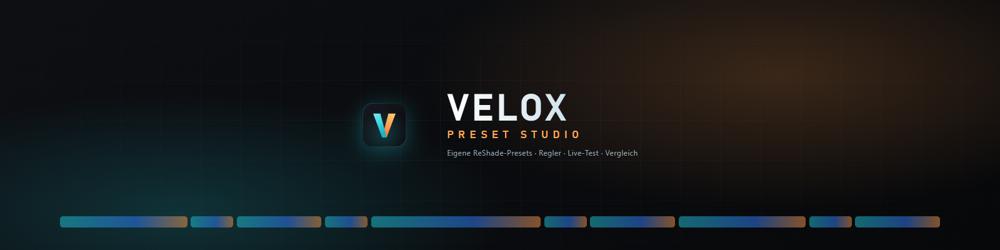
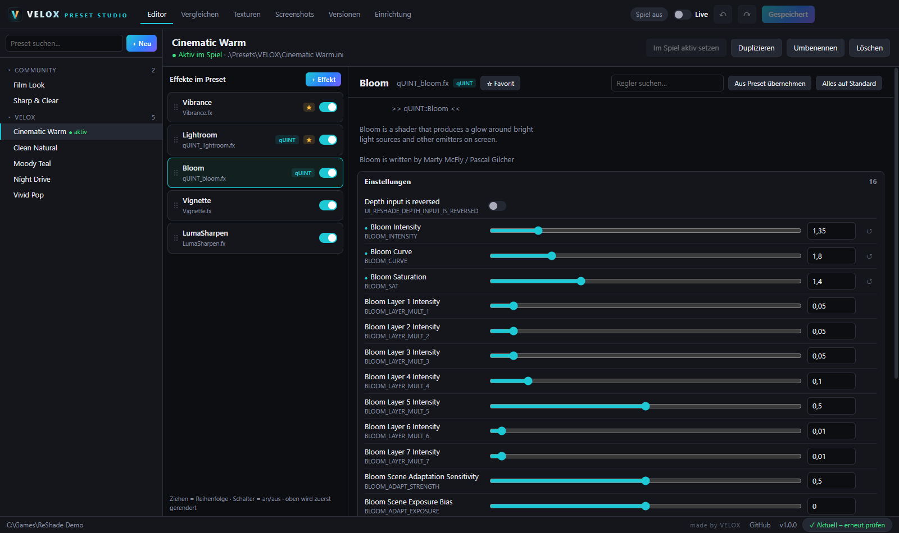

<p align="center">
  
</p>

<p align="center">
  <a href="../../releases/latest"></a>
  
  
  
</p>

<h3 align="center">Eigene ReShade-Presets bauen – mit Reglern statt Textdateien</h3>
<p align="center">Kostenlos. Liest einfach, was in deinem ReShade-Ordner liegt – <b>VELOX</b>.</p>

<p align="center"></p>

<p align="center">
  
</p>

<p align="center"></p>

## ⬇️ Download

1. Unter **[Releases](../../releases/latest)** die Datei `VELOX-Preset-Studio-Setup-x.y.z.exe` laden und starten.
2. Kommt *„Der Computer wurde durch Windows geschützt“*: **Weitere Informationen → Trotzdem ausführen** (die App ist nicht kostenpflichtig signiert).
3. Beim ersten Start den **ReShade-Ordner** wählen (dort, wo `ReShade.ini` liegt). Fertig.

Updates: unten rechts zeigt der Button, ob es eine neue Version gibt – ein Klick installiert sie.

<p align="center"></p>

## 🧩 Mod-Studio (neu)

Beim Start wählst du zwischen **ReShade-Presets** und **Mod-Studio**. Im Mod-Studio stellst du clientseitige Grafikmods (RPF im OIV-Aufbau, `.oiv`) zu einem eigenen Pack zusammen:

- **Eigener Arbeitsordner** – Mods werden hineinkopiert, deine Originale werden nie verändert
- **RPF / OIV öffnen**, Inhalt durchsuchen, Dateien exportieren (Texturen, Meta-Dateien …)
- **Konflikte erkennen**: welche Mods dieselbe Spieldatei ersetzen – die Reihenfolge entscheidet, wer gewinnt
- **Eigene Dateien** (z. B. bearbeitete Texturen) für ein Ziel einsetzen
- **Pack bauen**: eine einzige RPF mit `assembly.xml` – optional ohne Konflikt-Verlierer
- Geschützte/verschlüsselte Mods werden erkannt und nicht angetastet

<p align="center"></p>

## ✨ Was es kann

| | |
|---|---|
| 🎚️ **Regler für alles** | Jeder Shader in deinem `reshade-shaders`-Ordner wird eingelesen – Regler, Farbwähler, Auswahllisten, Tag/Nacht-Werte. Egal welches Shader-Paket du nutzt, es wird mit seinem Namen angezeigt |
| 🧱 **Effekte stapeln** | Effekte an/aus, per Ziehen sortieren, aus über 500 installierten Techniken hinzufügen, eigene **Favoriten** oben anpinnen |
| 🖼️ **Texturen & Optionen** | Shader-Optionen (Preprocessor) bearbeiten, LUTs / Lens-Dirt / Masken mit Vorschaubild auswählen |
| 🔀 **Vergleichen & mischen** | Zwei Presets nebeneinander, einzelne Werte oder ganze Effekte mit einem Klick übernehmen |
| ⚡ **Live testen** | Live-Modus schreibt jede Änderung sofort ins Preset – im Spiel nur noch die ReShade-Reload-Taste drücken |
| 🕘 **Versionen** | Jedes Speichern sichert automatisch, Rückgängig/Wiederholen, gelöschte Presets landen im eigenen Papierkorb |
| 📸 **Screenshots** | ReShade-Screenshots samt benutztem Preset, Vorher/Nachher-Schieber, Preset aus Screenshot wiederherstellen |
| 📦 **Pakete** | Liest alle installierten Shader-Pakete und zeigt sie mit Namen – unter jedem Preset stehen „Andere Effekte“ zum direkten Einschalten |
| 💡 **Erklärungen** | Maus über einen Regler oder Effekt: kurze Erklärung, was er macht, Standardwert und Bereich |
| 🎨 **Looks** | Ein Klick für wärmer, kälter, Kontrast, Sättigung, Helligkeit, Bloom, Schärfe, Vignette, Filmkorn, „Filmisch“ oder hellere Nächte |
| ☀️ **Tag / Nacht** | Bei Shadern mit getrennten Tag- und Nacht-Werten nur Tag oder nur Nacht anzeigen |
| 🧪 **Import & Check** | Fremde Presets importieren – die App zeigt sofort, welche Shader oder Texturen fehlen |
| 🎛️ **Mischen** | Zwei Presets stufenlos mischen, z. B. 70 % A und 30 % B |
| 🧹 **Aufräumen** | Doppelte, veraltete und unnötige Einträge entfernen |
| ⚡ **Leistung** | Schwere Effekte (SSR, AO, GI …) werden markiert, Gesamt-Last pro Preset |
| 🩺 **Shader-Fehler** | Liest `ReShade.log` und markiert Shader, die im Spiel nicht kompilieren oder Fehler melden |
| 🖼️ **Galerie** | Jedes Preset mit Vorschaubild aus deinen ReShade-Screenshots – automatisch zugeordnet oder selbst gewählt |
| 📌 **Meine Regler** | Lieblingsregler aus allen Effekten anpinnen und an einem Ort einstellen |
| 📤 **Teilen** | Preset als ZIP mit Texturen und Liste der benötigten Shader – Import mit Check auf der anderen Seite |
| ⬇️ **Shader-Pakete** | Pakete aus der offiziellen ReShade-Liste installieren und aktualisieren – fehlende Pakete direkt aus dem Import-Check |
| 💾 **Backup** | ReShade-Ordner sichern (nur Presets oder komplett) und wiederherstellen |
| 🌍 **Deutsch / English** | Sprache unten rechts umschalten |
| 🤖 **Claude-Fernsteuerung** | Eingebauter MCP-Server: Claude Code kann Presets öffnen, Regler setzen, Effekte schalten und Screenshots ansehen |

**Sicher:** VELOX Preset Studio ändert nur Textdateien (Presets, `ReShade.ini`). Es hängt sich nicht in Spiele ein und liest keinen Spielspeicher.

<p align="center"></p>

## 🎮 Im Spiel testen

1. Preset wählen → **Im Spiel aktiv setzen** (Spiel dafür schließen).
2. Unter **Einrichtung** eine **Reload-Taste** für ReShade festlegen.
3. Spiel starten, oben **Live** einschalten, Regler bewegen, im Spiel Reload drücken.
4. Das ReShade-Menü dabei geschlossen lassen, sonst speichert ReShade seine eigenen Werte drüber.

<p align="center"></p>

## 🤖 Claude (MCP)

Unter **Einrichtung → Fernsteuerung für Claude** steht der Befehl zum Kopieren, z. B.:

```bash
claude mcp add --scope user velox-preset -- node "C:\Users\<du>\AppData\Local\Programs\VELOX Preset Studio\resources\app.asar.unpacked\tools\vps-mcp.js"
```

Die App muss laufen. Die Verbindung geht nur über `127.0.0.1` mit einem zufälligen Schlüssel.

<p align="center"></p>

## 🛠️ Selbst bauen

```bash
npm install
npm start          # App starten
npm run dist       # Installer bauen (Ausgabe: dist/)
```

Lizenz: [MIT](LICENSE) · made by **VELOX**
